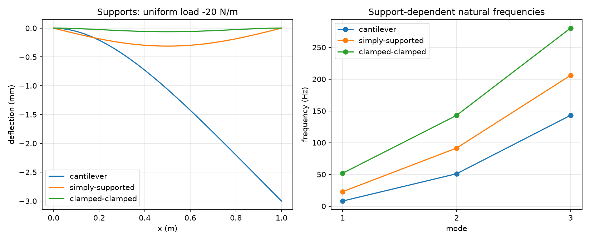
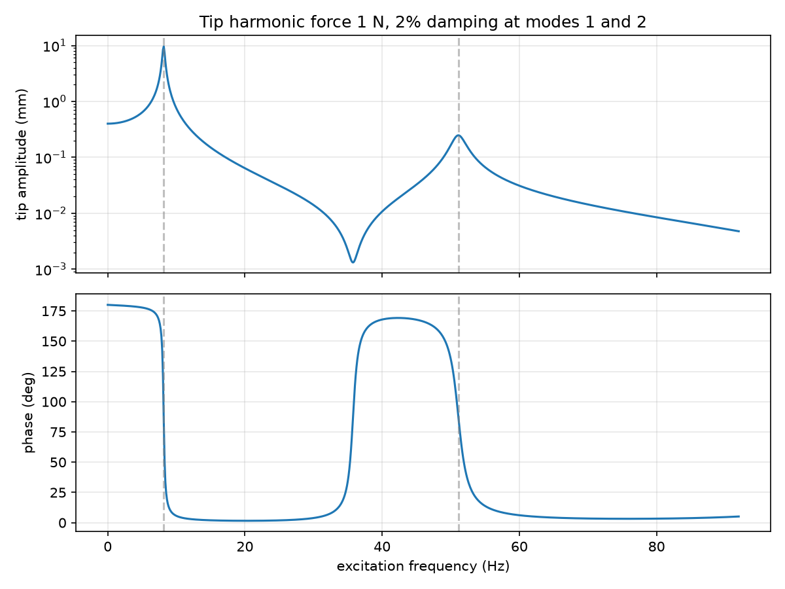
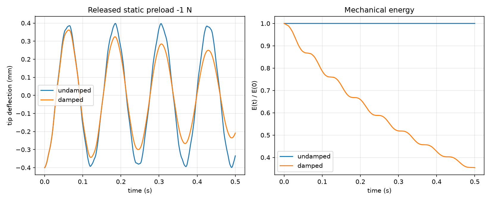

# Beam Vibration Lab：梁有限元振动实验平台

本项目在 [原梁振动项目](https://github.com/yanyana117/finite-element-vibration-simulation) 上扩展，适合展示“力学建模—数值求解—解析验证—工程化”的完整过程。
原作者提供基础悬臂梁求解器与六个算例，本版新增支承、载荷、谐响应、能量分析、命令行、安装包与自动验证。来源与许可状态见 [NOTICE.md](NOTICE.md)。

## 从原版到改造版

| 内容 | 原版 | 本版 |
|---|---|---|
| 支承 | 左端固支悬臂梁 | 悬臂、简支、两端固支 |
| 静力 | 端部力、均布载荷、节点挠度 | 增加任意节点力/力矩、节点转角、支反力 |
| 模态 | 频率、节点挠度振型 | 增加完整自由度振型、质量归一化、三种支承的解析参考 |
| 动力 | Newmark 位移时程 | 增加速度、加速度、动能、应变能、初始速度和位移 |
| 频域 | 无 | 复数谐响应、幅值与相位、双频阻尼拟合 |
| 使用 | 修改 Python 脚本 | 保留脚本，增加 JSON 配置和 beam-fem 命令 |
| 工程化 | requirements.txt | pyproject、安装包、CLI、测试、CI、复现实验记录 |



## 快速开始（Windows PowerShell）

```powershell
cd D:\CAE_Projects\beam-vibration-lab
python -m venv .venv
.\.venv\Scripts\python.exe -m pip install -e '.[dev]'
.\.venv\Scripts\python.exe -m pytest -q
.\.venv\Scripts\beam-fem.exe --config configs/cantilever_static.json --output runs/static
.\.venv\Scripts\python.exe scripts/run_all.py --output runs/latest
```

无需激活环境，避免 PowerShell 执行策略造成干扰。Linux/macOS 使用 `.venv/bin/python`。
核心求解只依赖 NumPy/SciPy；绘图需要 Matplotlib。开发安装包含绘图、pytest 和构建工具。

`configs/` 提供静力、简支模态、悬臂谐响应、悬臂自由衰减四个案例。
每次 CLI 分析生成 `input.json`（可复算）、`summary.json`、`data.csv` 和 `solution.npz`。
未知配置字段会报错，避免拼写错误被静默忽略。CSV 的谐响应监测节点在 summary 中记录：优先右端自由挠度，否则选自由挠度节点中的中间节点。

## 核心代码如何使用

```python
from fem_beam import steel_rectangular

b = steel_rectangular(n_elements=30, boundary="simply-supported")
F = b.load_vector(nodal_forces={15: -1}, nodal_moments={10: 0.1})
r = b.static_result(load=F)
print(r.deflection)  # m
print(r.rotation)    # rad
print(r.reactions)   # 偶数项 N，奇数项 N·m
```

节点编号从 0 开始。自由度顺序为 `[w0, theta0, w1, theta1, ...]`。
SI 单位：长度 m、杨氏模量 Pa、密度 kg/m³、力 N、均布力 N/m、力矩 N·m、频率 Hz、能量 J。
矩形截面宽 b、高 h，绕弯曲轴 `A=b*h`、`I=b*h³/12`。不要将 mm 直接传入代码。

旧接口 `static_deflection`、`natural_frequencies`、`transient_response` 保留；完整结果使用 `static_result`、`modal_result`、`transient_result`。
调用解析参考时必须是无 profile 的均匀梁；简支频率支持任意正整数模态数，悬臂和两端固支参考提供前五阶。




## 复现与展示

`scripts/run_all.py` 运行全部测试、七个算例脚本和四个 CLI 配置，汇总日志、测试 XML、运行清单与报告。任一步失败时整个流程返回非零值。
图形输出在 `results/`，详细时程与运行日志在被 Git 忽略的 `runs/`。仓库展示使用适量图形与验证记录，不上传虚拟环境和缓存。

建议项目介绍写为：“基于现有 Euler–Bernoulli 梁有限元求解器，扩展多支承条件、复数谐响应、动力学能量验证及可复现的命令行工作流。”
不要将原求解器和原算例全部称为个人原创。发布方法见 [GitHub 发布说明](docs/PUBLISHING.zh-CN.md)。

## 适用范围与三维示例

本版仍采用小变形线弹性 Euler–Bernoulli 梁理论，不包含剪切变形、转动惯量、塑性、接触、大变形或实体孔洞应力集中。
四个削弱区域使用逐单元 EI/rhoA 系数，属于等效模型，不是实际开孔实体网格。原材料对比中部分挠度相对梁长很大，仅用于理论参数比较。

`fenics/` 是需要独立 legacy FEniCS 环境的三维参考脚本。本次修正了箱梁几何、重力体力单位、顶部载荷方向及瞬态输出时间；没有在本机求解三维模型，不能将其写成验证通过。
详细假设、公式与数值验证见 [理论/API](docs/THEORY_AND_API.md) 和 [验证说明](docs/VALIDATION.md)。
